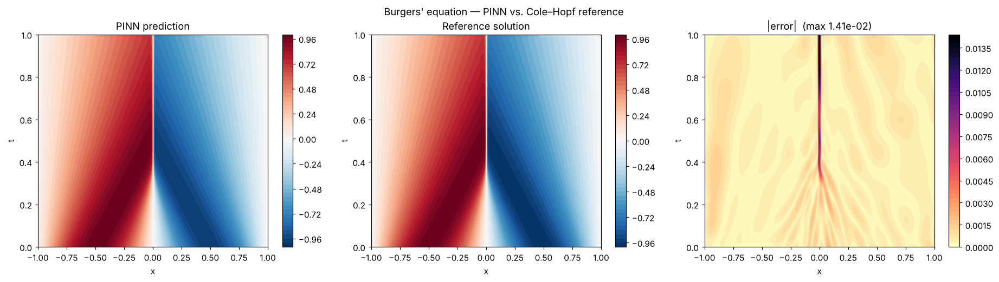

# neural-pde-solvers

[](https://github.com/tvh0ng/neural-pde-solvers/actions/workflows/ci.yml)


Physics-informed neural networks (PINNs) and deep-learning surrogate models for
computational mechanics — **Deep Learning Architecture Research Center (DLARC),
Sejong University**.

The repository has two independent parts:

| Part | Framework | What it does |
|---|---|---|
| `neural_pde_solvers.pinn` | PyTorch | Solves forward and inverse PDE problems by embedding the equation in the loss |
| `neural_pde_solvers.surrogate` | Keras 3 / TensorFlow | Learns a fast data-driven map from design parameters to a discretised response |

---

## Contents

- [Repository layout](#repository-layout)
- [Installation](#installation)
- [PINNs](#pinns)
- [Surrogate models](#surrogate-models)
- [Development](#development)
- [Citation](#citation)

## Repository layout

```
neural-pde-solvers/
├── src/neural_pde_solvers/
│   ├── pinn/
│   │   ├── networks.py     # MLP with optional skip connections and input normalisation
│   │   ├── autodiff.py     # gradient / partial / laplacian helpers
│   │   ├── problems.py     # Heat1D, Burgers1D, Poisson2D, DiffusionInverse1D
│   │   ├── trainer.py      # Adam (+ optional L-BFGS) training loop, evaluation
│   │   ├── experiment.py   # config-driven runs and artifact saving
│   │   └── plotting.py
│   ├── surrogate/
│   │   ├── config.py       # typed experiment config
│   │   ├── data.py         # loading, train/val/test split, leakage-free scaling
│   │   ├── models.py       # ANN, 1D-CNN, SimpleRNN, GRU, LSTM, CNN-GRU
│   │   ├── metrics.py      # streaming R², regression report
│   │   ├── train.py        # training pipeline and artifact saving
│   │   └── plotting.py
│   └── utils.py            # seeding, logging, YAML I/O
├── configs/
│   ├── pinn/               # one YAML per PDE problem
│   └── surrogate/          # one YAML per architecture
├── notebooks/
│   ├── pinn/               # 01–04 step-by-step tutorials
│   └── surrogate/          # train_surrogate.ipynb (any architecture)
├── scripts/make_synthetic_data.py
├── data/README.md          # expected CSV format (data are not versioned)
└── tests/
```

## Installation

```bash
git clone https://github.com/tvh0ng/neural-pde-solvers.git
cd neural-pde-solvers
python -m venv .venv && source .venv/bin/activate

pip install -e ".[pinn]"        # PINNs only (PyTorch)
pip install -e ".[surrogate]"   # surrogate models only (TensorFlow)
pip install -e ".[all]"         # everything, including dev tools
```

> PyTorch and TensorFlow are kept in separate extras and are never imported together:
> loading both into one Python process can crash. Use separate kernels/processes.

**Google Colab:** every notebook installs what it needs in its first cell.

## PINNs

| # | Problem | Equation | Highlights | Notebook |
|---|---|---|---|---|
| 1 | Steady heat, 1D | $u'' = -\sin \pi x$ | autograd, BC loss | [`01_heat_equation_1d`](notebooks/pinn/01_heat_equation_1d.ipynb) |
| 2 | Burgers, 1D + time | $u_t + u u_x = \nu u_{xx}$ | nonlinear, IC + BC, L-BFGS, Cole–Hopf reference | [`02_burgers_equation`](notebooks/pinn/02_burgers_equation.ipynb) |
| 3 | Poisson, 2D | $\Delta u = -2\pi^2 \sin \pi x \sin \pi y$ | 2D domain, residual MLP | [`03_poisson_2d`](notebooks/pinn/03_poisson_2d.ipynb) |
| 4 | Inverse diffusion | $u_t = D u_{xx}$, $D$ unknown | parameter identification from noisy data | [`04_inverse_diffusion`](notebooks/pinn/04_inverse_diffusion.ipynb) |

### Run from the command line

```bash
pinn-run configs/pinn/burgers1d.yaml                 # artifacts -> results/pinn/burgers1d/
pinn-run configs/pinn/heat1d.yaml --epochs 2000 --device cpu
```

Each run writes `config.yaml`, `model.pt`, `history.csv` and `metrics.json`.

### Use as a library

```python
from neural_pde_solvers.pinn import MLP, Poisson2D, PINNTrainer, TrainerConfig, evaluate

problem = Poisson2D()
model = MLP(in_dim=2, width=64, depth=6, residual=True)
PINNTrainer(model, problem, TrainerConfig(epochs=8000, n_collocation=5000)).fit()
print(evaluate(model, problem))        # {'rel_l2': ..., 'max_abs': ..., 'mean_abs': ...}
```

A new PDE only needs a subclass of `PDEProblem` implementing `residual` and `losses`
(and optionally `exact`). Unknown physical parameters are declared as `nn.Parameter`
on the problem and are optimised automatically.

### Reference results

Relative L2 error against the analytic (or Cole–Hopf) solution with the shipped
configs, seed 42, CPU:

| Problem | Relative L2 | Max abs. error | Identified parameter | Train time (CPU) |
|---|---|---|---|---|
| 1D heat | 1.34e-03 | 1.23e-04 | — | 2.4 min |
| Burgers | 1.52e-03 | 1.41e-02 | — | 9.9 min |
| 2D Poisson | 7.41e-03 | 5.79e-03 | — | 8.5 min |
| Inverse diffusion | 1.14e-03 | 2.89e-03 | D = 0.10015 (true 0.1, error 0.15%) | 7.6 min |



## Surrogate models

Six architectures for multi-output regression (design parameters → response curve):

| Key | Architecture | Config |
|---|---|---|
| `ann` | Dense ×4 + BatchNorm | [`ann.yaml`](configs/surrogate/ann.yaml) |
| `cnn1d` | Conv1D ×3 → MaxPool → Dense ×2 | [`cnn1d.yaml`](configs/surrogate/cnn1d.yaml) |
| `rnn` | SimpleRNN ×4 → Dense | [`rnn.yaml`](configs/surrogate/rnn.yaml) |
| `gru` | GRU ×3 → Dense | [`gru.yaml`](configs/surrogate/gru.yaml) |
| `lstm` | LSTM ×4 (optionally bidirectional) | [`lstm.yaml`](configs/surrogate/lstm.yaml) |
| `cnn_gru` | Conv1D ×2 → GRU ×2 → Dense ×2 | [`cnn_gru.yaml`](configs/surrogate/cnn_gru.yaml) |

```bash
surrogate-train configs/surrogate/lstm.yaml --data-path /path/to/Out_ML_cm.csv

# no data at hand? try it on synthetic data
python scripts/make_synthetic_data.py data/synthetic.csv --rows 3000
surrogate-train configs/surrogate/gru.yaml --data-path data/synthetic.csv --epochs 50
```

Each run writes `best.keras`, `scalers.joblib`, `history.csv`, `metrics.json` and
`config.yaml` to `output_dir`. The data format is described in
[`data/README.md`](data/README.md).

**Evaluation protocol**

- Rows are split into train / validation / test (default 72 / 8 / 20 %, original row
  order preserved; set `shuffle: true` to randomise).
- Min-max scalers are fitted on the training block only.
- Early stopping, LR reduction and checkpoint selection use the validation block; the
  test block is evaluated once at the end.
- MSE, RMSE, MAE and R² are reported both in scaled and in physical units.

```python
from neural_pde_solvers.surrogate import load_trained, reshape_inputs

model, scalers, cfg = load_trained("results/surrogate/lstm")
x = scalers["x"].transform(x_raw)                                 # (N, n_inputs)
y = scalers["y"].inverse_transform(model.predict(reshape_inputs(x, "sequence")))
```

## Development

```bash
pip install -e ".[all]"
make lint        # ruff
make test        # PyTorch and TensorFlow suites, in separate processes
make notebooks   # execute every notebook with short runs
pre-commit install
```

CI (GitHub Actions) runs linting, both test suites and all notebooks on every push
and pull request. See [`CHANGELOG.md`](CHANGELOG.md) for what changed from the
original notebooks.

## Citation

If this code is useful in your work, please cite:

```bibtex
@software{truong_neural_pde_solvers,
  author       = {Truong, Van Hong},
  title        = {{neural-pde-solvers}: Physics-informed neural networks and deep-learning surrogate models},
  organization = {Deep Learning Architecture Research Center, Sejong University},
  url          = {https://github.com/tvh0ng/neural-pde-solvers},
  year         = {2026}
}
```

The PINN formulation follows Raissi, Perdikaris & Karniadakis, *Physics-informed neural
networks*, J. Comput. Phys. 378 (2019) 686–707.
